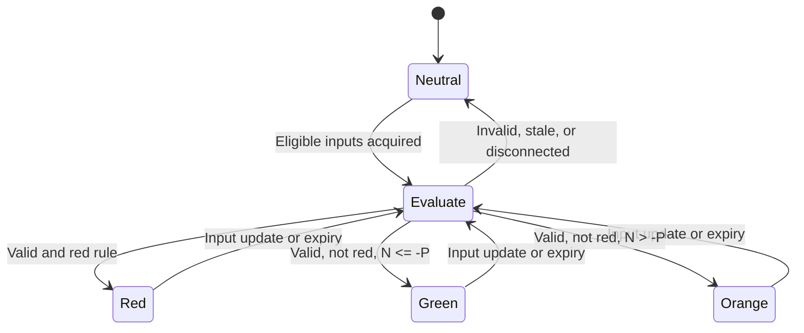

# Example: advisory appliance indicator

Synthetic specification only; no live settings or implementation approval.

| Symbol | Definition / source | Validation |
| --- | --- | --- |
| I | Normalized HA grid-import power, configurable import mapping | W, finite, nonnegative, fresh |
| E | Normalized HA grid-export power, configurable export mapping | W, finite, nonnegative, fresh and coherent with I |
| N | I - E, derived signed instantaneous grid power | W; positive import, negative export |
| P | Appliance required power from proposed setting `appliance.requiredPowerW` | W, finite, strictly positive |
| K | Import peak limit from proposed setting `indicator.importPeakLimitW` | W, finite, nonnegative |
| M | Safety margin from proposed setting `indicator.safetyMarginW` | W, finite, 0 <= M <= K |

The proposed setting names must be mapped to actual consumer settings before
approval. No default live values are assumed; missing settings yield neutral.
Freshness/coherence limits come from existing grid settings, not new implicit
defaults. K is an instantaneous indicator threshold, not certified tariff demand.

Evaluate top-to-bottom, first matching rule wins:

| Order | Condition | State |
| --- | --- | --- |
| 1 | Missing, stale, invalid, disconnected, or incoherent required input/setting | Neutral/unavailable |
| 2 | N > K OR N + P > K - M | Red/blocking advisory |
| 3 | N <= -P | Green |
| 4 | Otherwise | Orange |

Red wins over green. Equality at N = K and N + P = K - M does not trigger
that red comparison, but the other red condition can still win. N = -P is green
only if neither red condition holds. Zero grid power is valid only when fresh;
P = 0, negative import/export, and nonfinite values are invalid.

Eligibility is re-evaluated on updates, expiry, settings changes, and disconnect;
reconnect starts neutral until eligible measurements are reacquired.

The example assumes P is an additional prospective load not already represented
in N. If the appliance is already running, N + P double-counts its load; specify
that case separately before approval. Do not add inverter production again if
the grid net already reflects it.

This indicator is advisory only. It must not change physical GO, appliance
control, scheduling, hardware ownership, HA transport, or staleness windows.
Test immediately below/equal/above each threshold, invalid settings and readings,
expiry without a new event, reconnect, and red/green conflicts before acceptance.
The owner must approve the actual feature specification before implementation.
